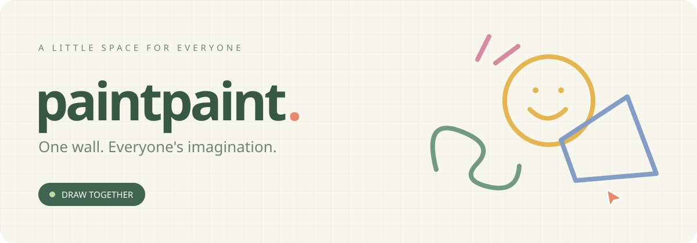
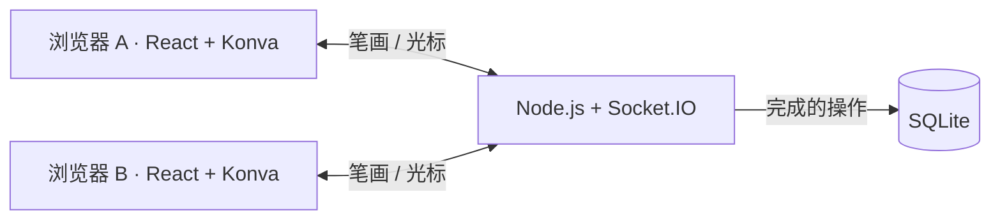

<p align="center"></p>

<h1 align="center">一起涂 · paintpaint</h1>
<p align="center">打开网页，选一个颜色，和世界一起留下这一笔。</p>
<p align="center">
  <a href="https://paintpaint.happycyn.cn">在线画板</a> ·
  <a href="#快速开始">本地运行</a> ·
  <a href="docs/deployment.md">自行部署</a>
</p>
<p align="center">
  <a href="https://github.com/dajiba6/paintpaint/actions/workflows/ci.yml"></a>
  
  
  
</p>

---

**一面公共涂鸦墙，所有人一起画。** 无需注册，无需创建房间；每个访客看到同一张画布，能实时看到其他人的笔迹和光标。

## 在这里，可以做什么？

| 🎨 随手创作 | 🤝 一起画画 | 💾 留下作品 |
| --- | --- | --- |
| 自由画笔、直线、圆、多边形 | 实时笔迹和在线光标 | SQLite 持久化保存 |
| 预设色与自由调色盘 | 匿名昵称与在线人数 | 撤销自己的操作 |
| 橡皮擦、缩放和移动 | 断线重连后恢复画面 | 服务重启后作品保留 |

画板固定为 **2400 × 1600**，进入时居中铺满可用区域；缩小或拖动即可查看画布边缘。桌面支持鼠标和快捷键，移动端支持单指绘画、双指移动与缩放。

## 快速开始

需要 **Node.js 24 LTS** 和 npm。

```bash
git clone https://github.com/dajiba6/paintpaint.git
cd paintpaint
npm ci
npm run dev
```

打开 **http://localhost:5173**。普通窗口和无痕窗口可以模拟两个不同访客；同一浏览器的多个标签页共用访客身份。

```bash
npm test       # 运行独立临时数据库上的测试
npm run build  # 生成生产前端
npm start      # 提供前端与实时服务：http://localhost:3001
```

## 拿起画笔

| 工具 | 操作 | 快捷键 |
| --- | --- | --- |
| 画笔 | 按住拖动，自由绘画 | `B` |
| 橡皮擦 | 拖动擦除笔迹，保留背景网格 | `E` |
| 直线 | 从起点拖到终点 | `L` |
| 圆 | 从圆心向外拖动 | `C` |
| 多边形 | 逐点点击；双击、点击起点或点击「完成」闭合 | `P` / `Enter` 完成 / `Esc` 取消 |
| 移动画布 | 切换手掌工具，或按住空格拖动 | `H` / `Space` |
| 缩放 | 滚轮、右下角按钮；手机双指缩放 | — |
| 撤销 | 撤销自己的最近一次操作，包括擦除 | `⌘ Z` / `Ctrl Z` |

彩色圆环打开自由调色盘。橡皮擦会擦到公共画板上已有的笔迹，撤销擦除可以恢复被擦掉的部分。

## 它是怎么工作的？



- **本地立即绘制**，每约 40ms 同步当前笔画预览，完成后提交最终版本。
- **服务端确定顺序**，为操作分配序号；重连时下发当前画面。
- **匿名身份**保存在浏览器中，服务端推导所有权，撤销只能操作自己的记录。
- **撤销保留删除标记**，避免延迟到达的重试让已撤销的笔画复活。
- **笔迹与背景分层**，橡皮擦通过透明合成擦除笔迹，不用白色覆盖网格。

```text
src/                 画板界面、绘制交互与样式
server/              实时服务、数据校验与 SQLite 存储
test/                多人同步、恢复、撤销与图形测试
docs/                项目横幅与部署说明
edge/                HTTPS / WebSocket 转发入口
deploy/              Ubuntu systemd 服务模板
Dockerfile           Node 24 多阶段生产镜像
compose.yaml         服务与持久化数据卷
```

## 部署

```bash
docker compose up -d --build
```

默认只监听宿主机 **127.0.0.1:3088**。SQLite 存在独立 Docker 数据卷中，容器更新不会清空画板。将 HTTPS 反向代理或 Cloudflare Tunnel 指向此端口即可；如果 Tunnel 本身在容器中，需要使用该容器可达的宿主机地址。

当前在线实例使用 **Ubuntu + Node 24 + systemd** 常驻运行，Cloudflare Worker 仅作为 HTTPS / WebSocket 入口，通过 Tunnel 连接服务器。作品保存在 Ubuntu 的 SQLite 文件中。Docker 是可选的自托管方式。

详细步骤、升级、备份和 Cloudflare Tunnel 配置见 **[部署说明](docs/deployment.md)**。

## 数据与当前边界

- 清除浏览器数据后会获得新身份，无法再撤销旧身份的笔画。
- 已完成的操作持久化；光标和未完成的预览只在内存中。刷新或关闭页面可能丢失尚未确认保存的操作。断线时未完成的多边形草稿会取消。
- 每笔最多 6000 个坐标点，单条消息最大 256KB，并有每连接事件频率限制。
- 当前使用单进程和单公共画板，尚未进行大规模压测，也未提供管理员清空、内容审核、按 IP 防刷或多实例同步。大量历史笔画需要进一步做快照压缩或按区域加载。
- 测试覆盖实时同步、断线恢复、重启持久化、操作所有权、撤销与重试、图形颜色保存、草稿取消和圆的边界。

---

<p align="center">画得好不好不重要。<br/><strong>给世界，添一点颜色。</strong></p>
